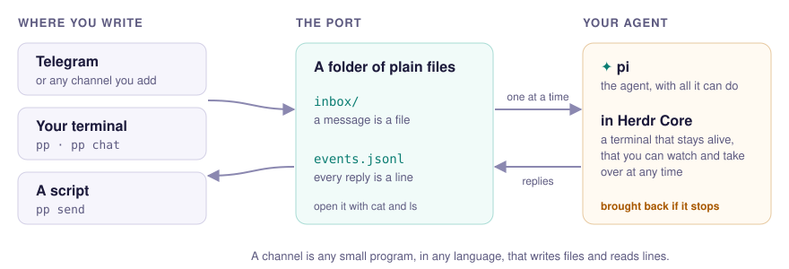

<p align="center">
  
</p>

<h1 align="center">Pi-Personal</h1>

<p align="center">
  <strong>Your own agent, always there.</strong><br>
  A powerful agent, in a capable environment, that you can reach from anywhere.
</p>

<p align="center">
  <a href="#install">install</a> · <a href="#how-it-works">how it works</a> · <a href="docs/guide.md">guide</a> · <a href="#learn-more">docs</a> · <a href="CONTRIBUTING.md">contributing</a>
</p>

<p align="center">
  
</p>

Pi-Personal gives you an agent of your own: a [pi](https://github.com/earendil-works/pi) session that lives on your machine, in [Herdr Core](https://herdr.dev), and answers wherever you write to it.

- **One line to install.** A guide in five steps does the rest: Herdr Core (yours, if you have one), a model with pi's own sign-in, your agent, Telegram. About four minutes. [guide →](docs/guide.md)
- **Always there.** It runs in the background, comes back by itself after a crash or a restart of the machine (the guide sets this up), and picks up the work that was cut off.
- **Watch it, take over.** `pp` shows how it is doing; Enter opens its screen, which is all of pi; `ctrl+\` comes back, and it keeps working.
- **Reach it from anywhere.** Telegram is built in. Any other service is a small program, in any language. [write a channel →](docs/write-a-channel.md)
- **It sets itself up.** Ask it to change its model, its instructions or who may write to it: it knows how, and takes such requests from its owner only. [its manual →](docs/for-agents.md)
- **Yours.** Everything is a plain file you can read. Secrets stay in a folder only you can open. No account, no telemetry.

## Install

```sh
curl -fsSL https://raw.githubusercontent.com/emiwltz/pi-personal/main/install.sh | sh
```

Linux or macOS. The installer brings Node.js if it is missing, changes nothing else without asking, and ends in the guide. Then, every day:

```sh
pp            # how your agent is doing: Enter opens it, ctrl+\ comes back
```

| | |
|---|---|
| `pp setup` | set things up, or change them: a channel, the model |
| `pp status` | what it and its channels are doing, and why |
| `pp doctor` | check everything, by topic, with what to do |
| `pp update` | the newest Pi-Personal, with the pi it was tested with |
| `pp help` | the rest (`pp help --all` lists every command) |

> [!IMPORTANT]
> Your agent is pi, the coding agent: it can do anything your user account can do on this machine. There is no sandbox. Read [security](docs/security.md) before you let anyone else write to it.

## How it works

<p align="center">
  
</p>

The core is three parts, and does nothing else:

- **pi** is the agent, with its tools, extensions, skills and MCP servers.
- **Herdr Core** is where it lives: a terminal that keeps running in the background, where the agent can open other sessions.
- **The port** is how anything reaches it: a folder of plain files. A message is a file; every reply is a line.

A message is never lost and never handled twice, a reply never goes to someone it was not meant for, and every message ends with a reply or an error, even when pi crashes in the middle of its work. What a messaging service does its own way belongs to its channel; what an agent could do belongs to pi's extensions. The core never changes to add an ability.

## Learn more

[the guide](docs/guide.md) · [concepts](docs/concepts.md) · [security](docs/security.md) · [Telegram](channels/telegram/README.md) · [write a channel](docs/write-a-channel.md) · [the port](docs/port.md) · [a map of the code](docs/code.md) · [decisions](docs/decisions/)

## Status

Version 0.4, early. Tested on Linux and macOS (arm64), with pi 1.5.2, Herdr Core 0.1.18 to 0.1.21, and Node.js 22 and 24; installed from scratch on a simulated fresh machine on both, and used for real with a hosted model and Telegram. Not yet proven: weeks of continuous use, a power cut, a real fresh machine of every kind.

Pi-Personal follows pi: a new pi is adopted once the tests pass with it, and `pp update` brings it.

## Contributing

About 6,000 lines of TypeScript, run directly by Node.js, with one dependency: pi. Checked by 185 tests that run the real pi in an isolated Herdr Core, kill it in the middle of its work, and fill its disk.

```sh
git clone https://github.com/emiwltz/pi-personal.git && cd pi-personal
npm ci
npm test      # about 15 minutes; needs Herdr Core's hc on your PATH, never touches your own agents
```

If you are a person or an agent working on this repository, read [CONTRIBUTING.md](CONTRIBUTING.md) first: what the project must stay, how it is tested, how a version is made.

## Thanks

Pi-Personal is an independent project, standing on two others: [pi](https://github.com/earendil-works/pi), the agent, and [Herdr Core](https://github.com/herdrdev/herdr-core), the place it lives. ✦ The agent is a star that stays lit.

[MIT](LICENSE)
