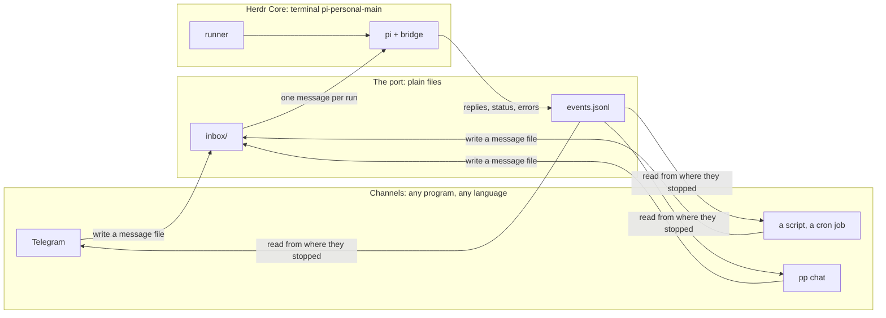

# Pi-personal

**A powerful agent, in a capable environment, that you can reach from anywhere.**

Pi-personal gives you your own agent: a [pi](https://github.com/earendil-works/pi) session that lives on your machine, in [Herdr Core](https://herdr.dev), and answers wherever you write to it: its terminal, your shell, Telegram, or any channel you add.

- **Install in one line.** The guide sets up everything else: Herdr Core, a model provider (any that pi supports), your agent, Telegram.
- **Always there.** It runs in the background, comes back by itself after a crash, and continues the work that was cut off.
- **Watch it, take over.** It works in a real terminal you can attach to at any time, with all of pi.
- **Yours.** Everything is a file you can read; its secrets stay in a folder only you can open.

```sh
curl -fsSL https://raw.githubusercontent.com/emiwltz/pi-personal/main/install.sh | sh
```

Linux or macOS. The installer brings what is missing (Node.js, Herdr Core), changes nothing else on the machine without asking, and ends in the guide, for example:

```
2/5  A model provider
  ? How do you want to connect?
    › Sign in with an account  a subscription or an account, in your browser
      Use an API key  a key from the provider's website
…
4/5  Start it
  ✔ main runs in Herdr Core, in the background: closing this window does not stop it
  main › Hello! I'm main, your agent on this machine. What shall we start with?
```

Then:

```sh
pp            # how your agent is doing, and what to do next
pp chat       # talk to it here
pp attach     # watch it work in its terminal, or take over (ctrl+\ to leave)
```

Pi-personal is an independent project built on pi. It is not a sandbox: your agent can do anything your user account can do, as pi can ([security](docs/security.md)).

## How it works



The core is three parts and does nothing else:

- **pi**, the agent itself, with all its tools, extensions, skills and MCP servers;
- **Herdr Core**, where it lives: a terminal that keeps running in the background, where the agent can open other sessions;
- **the port**, a folder of plain files through which anything talks to it. A channel writes a message as a file; the agent takes one message per run; every reply, and the end of every message, is a line in an events file that channels read.

Its promises hold under crashes: a message is never lost and never handled twice, a reply never goes to someone it was not meant for, and every message ends with a reply or an error. About 2,900 lines of TypeScript run directly by Node.js, with one dependency (pi, pinned), checked by over 140 tests that run the real pi in an isolated Herdr Core, kill it in the middle of its work, and fill its disk.

Everything a messaging service does its own way (formatting, groups, voice, reactions) belongs to its channel; everything else an agent could do belongs to pi's extensions. The core never changes to add an ability.

## Learn more

- [The guide](docs/guide.md): install, setup, everyday use, channels, starting at login, updates, backups, uninstalling.
- [Concepts](docs/concepts.md): agent, folder, session, keeper, port, bridge, channels, extensions.
- [Security](docs/security.md): what Pi-personal trusts, and what can go wrong. Read it before you let anyone else talk to your agent.
- [The Telegram channel](channels/telegram/README.md), and [how to write your own](docs/write-a-channel.md) for another service, in any language.
- [The port](docs/port.md): the protocol, for anyone writing a client.
- [A map of the code](docs/code.md), and the [decisions](docs/decisions/) behind the design.

## Project status

Version 0.2, early. Tested on Linux (arm64) and macOS (arm64), with pi 1.5.2, Herdr Core 0.1.18 to 0.1.21, and Node.js 22 and 24; installed from scratch on a simulated fresh machine on both. Used for real with a hosted model and the Telegram channel. Not yet proven: weeks of continuous use, a power cut, a real fresh machine of every kind.

Pi-personal follows pi: a new pi version is adopted once the tests pass with it (`test/contracts.test.ts` says first which of pi's behaviours changed), and `pp update` brings it.

## Development

```sh
git clone https://github.com/emiwltz/pi-personal.git && cd pi-personal
npm ci
npm test                                  # about 15 minutes
node --test test/fresh-install.manual.ts  # before a release: a fresh machine, simulated (downloads about 100 MB)
```

The tests need Herdr Core's `hc` on your `PATH`. Each test file starts its own isolated Herdr Core (its own session name and runtime folders, checked against your default core before anything is stopped), the real pi, and a fake model: nothing touches your own agents or your Herdr Core. [docs/code.md](docs/code.md) maps the code.

## License

[MIT](LICENSE).
