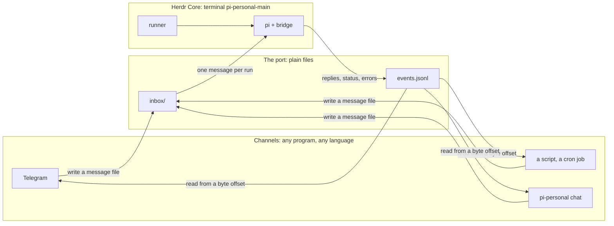

# Pi-personal

**Personal agents that live on your own machine.**

Write to your agent from your phone, a script or its own terminal, and it answers. It comes back by itself after a crash or a reboot. And everything it does is a file you can `ls` and `cat`.

Each agent is one continuous [pi](https://github.com/earendil-works/pi) session (pi is an open-source coding agent for the terminal; Pi-personal is an independent project built on it). It lives in a folder and runs in a terminal of [Herdr Core](https://herdr.dev), a program that keeps terminals alive, so it sits next to your other sessions. Messages come in and go out through **the port**, a folder of plain files: Telegram ships with Pi-personal, and any other channel is a small program you write, in any language.

Not a sandbox: the agent can do anything your user account can do, as pi can ([security](docs/security.md)).



## Why Pi-personal

- **A core with as little responsibility as possible.** Three parts: **pi** (the agent and its session), **Herdr Core** (where the agent lives, and where it can open other sessions), and **the port** (a folder of plain files through which anything talks to it). The core is about 2,900 lines of TypeScript (the two channels add about 600), with one dependency (pi, pinned) and no build step.
- **Guarantees that hold under crashes.** A message is never lost and never handled twice; a reply never goes to someone it was not meant for; every message ends with a reply or an error naming it. The agent comes back by itself after a crash, and resumes the work that was cut off. Checked by 141 tests, most of them end to end with the real pi in a real (isolated) Herdr Core, including tests that kill pi or the keeper in the middle of a run, or stop Herdr Core as a reboot would; every defect found so far has a test of its own.
- **Transparent.** Everything is a file you can `ls` and `cat`. `pi-personal status` and `pi-personal log` say what happened and why: every restart, failure and safe mode with its reason.
- **Extensible without touching the core.** A channel is a separate program, in any language, that writes and reads files. Inside the agent you have all of pi: extensions, packages, skills, MCP servers. A channel and a pi extension together can stream a reply as it forms, react, or stop a run; names containing a dot are reserved for them ([the port](docs/port.md#room-for-extensions)).
- **Yours.** It runs as you, on your machine. Secrets stay in a private area readable by you alone; the agent's folder holds none and can be shared or kept under git.

What it is not: a hosted service, or a scheduler (anything that can run a command can wake it up). Groups, voice, reactions and buttons belong to channels, not to the core.

## Quick start

You need Linux or macOS, Node.js 22.19+, git, Herdr Core's `hc` command, and an account with a model provider ([details](#requirements)).

```sh
git clone https://github.com/emiwltz/pi-personal.git && cd pi-personal && ./install.sh
pi-personal login anthropic                                  # once, shared by all agents
pi-personal init main --model anthropic/claude-haiku-5-5     # pi-personal models lists the ids you can use
pi-personal start main
pi-personal send main "Hello. Who are you, and where do you live? Two short sentences." --wait
```

For example:

```
I am main, a personal agent run by Pi-personal. I live in /home/you/pi-personal/main.
```

```
$ pi-personal status main
main  idle  anthropic/claude-haiku-5-5  ~/pi-personal/main
  terminal t6b
  channel telegram  running
```

Below: [how it works](#how-it-works), then step by step: [requirements](#requirements), [install](#install), [your first agent](#your-first-agent), [channels](#add-a-channel), [starting at login](#start-at-login), [everyday commands](#everyday-commands), [where things live](#where-things-live).

## How it works

1. **A channel writes a message** as one JSON file in the agent's `inbox/` (written under a temporary name, then linked into place, so the agent never sees half a file). The file is the receipt: once it is there, the message will reach the agent, whatever crashes.
2. **The bridge**, the one piece of Pi-personal inside pi, hands the oldest waiting message to pi when pi is idle: one message per run. The message enters pi's own session with its id, and only once it is stored on disk is it reported `taken`.
3. **pi works**, with all its tools. Whatever it says becomes events in `events.jsonl`: each reply names the message it answers, and every message ends with one `settled` event (carrying the error when there was no reply).
4. **The channel reads the events** from where it stopped, a byte offset, and sends each reply where it belongs: the conversation (`telegram:4242`) is the address.
5. **The keeper** keeps it all running, in two parts. A **runner** in each Herdr Core terminal keeps pi (or a channel) alive there: it restarts it after a crash (and the bridge asks the agent to continue the work that was cut off), gives up after repeated failures and tries again every hour, and starts pi without its extensions (safe mode) when one of them breaks loading. **`pi-personal up`**, run by hand or by the optional login service, starts whatever should be running and is not.

The details: [concepts](docs/concepts.md), [the port protocol](docs/port.md), [a map of the code](docs/code.md), and the [decisions](docs/decisions/) behind the design.

## Requirements

- **Linux or macOS.** Windows is not supported.
- **Node.js 22.19 or newer**, with npm.
- **Herdr Core 0.1.18 or newer**: its `hc` command, on your `PATH`, is the part you need; Herdr's desktop app is optional. Get it at <https://herdr.dev>.
- **git**, to get the source.
- **An account with a model provider** that pi supports (an API key or a subscription sign-in).

You do not need pi installed. Pi-personal installs and pins its own copy (pi 1.5.2), separate from any pi you already have.

## Install

```sh
git clone https://github.com/emiwltz/pi-personal.git
cd pi-personal
./install.sh
pi-personal doctor
```

`install.sh` puts Pi-personal in `~/.local/share/pi-personal` and the `pi-personal` command in `~/.local/bin`. If it says so, add `~/.local/bin` to your `PATH`. To update later: `git pull` in the cloned folder, `./install.sh` again, then `pi-personal restart <name>` for each agent (conversations continue).

`pi-personal doctor` prints one line per check: `ok`, `note` (fine for now, for example "login service not installed") or `FAIL`. Fix every `FAIL` before going on.

## Your first agent

**1. Create it.** Pick a model with pi's syntax, `provider/id`, the same string you would pass to `pi --model`. `pi-personal models` lists the models of the providers you are signed in to (step 2); before that, it says how to sign in:

```sh
pi-personal init main --model <provider>/<model-id>
```

This creates the folder `~/pi-personal/main` with two files: `AGENTS.md` (the agent's instructions, yours to edit) and `pi-personal.json` (its settings). To put the folder elsewhere: `pi-personal init main ~/somewhere/main --model ...`. You can also set or change the model later in `pi-personal.json`:

```json
{
  "model": "<provider>/<model-id>"
}
```

**2. Sign in to your provider.**

```sh
pi-personal login <provider>
```

This runs pi's own `pi auth login <provider>`: it opens a browser sign-in, or asks for an API key. Credentials are pi's, stored by pi in Pi-personal's private area, and shared by all your agents. Signing in to your own pi does not count: Pi-personal's pi has its own configuration, so sign in here once. Run `pi-personal doctor` again: it should say `credentials ready` for your agent's model.

**3. Start it.**

```sh
pi-personal start main
```

It says `main: started; pi is ready` once pi is up and reading messages (or why not, if it is not). The agent runs in a Herdr Core terminal named `pi-personal-main`. Starting it again does nothing and says "already running".

**4. Talk to it.**

```sh
pi-personal send main "Hello. Who are you?" --wait   # send one message, print the answer
pi-personal chat main                               # a conversation here; Ctrl+D to leave
pi-personal attach main                             # the agent's own terminal; ctrl+\ to leave
```

In the attached terminal you are typing into pi itself, with everything pi offers. Typed messages and messages from channels coexist. If you quit pi there, Pi-personal starts it again; to stop the agent, use `pi-personal stop main`.

## Add a channel

A channel is a small program, next to the agent, that connects it to a messaging service. Pi-personal ships one: **Telegram**, set up in five steps in [channels/telegram/README.md](channels/telegram/README.md) (create a bot, store its token, turn the channel on, allow yourself). Any other service is a program you write, or someone else wrote, in any language: [docs/write-a-channel.md](docs/write-a-channel.md).

## Start at login

```sh
pi-personal service install
```

On Linux this installs a systemd user timer; on macOS a launchd agent. At login and every 5 minutes it runs `pi-personal up --if-running`, which starts every agent and channel that should run and touches nothing else. It never starts Herdr Core itself: if Herdr Core is not running, it does nothing and tries again at the next round. An agent you stopped with `pi-personal stop` stays stopped until you `pi-personal start` it.

`pi-personal service status` tells you if it is installed; `pi-personal service uninstall` removes it. Pi-personal works without the service; you then start agents by hand after a reboot.

**A machine nobody logs in to** (a Raspberry Pi, a server). On Linux, user timers run only while you are logged in, unless you run `loginctl enable-linger $USER` once. And the service never starts Herdr Core: after a reboot, agents come back at the first round after Herdr Core is running again (any `hc` command starts it, from your own environment). Pi-personal leaves this to you on purpose: a Herdr Core started by a service would run with the service's bare environment, and every terminal in it too.

## Everyday commands

| Command | What it does |
|---|---|
| `pi-personal status [name]` | One line per agent; with a name: its state, last error, last restart and why, safe mode, each channel |
| `pi-personal start <name>` | Start an agent and its channels, and say when pi is ready; does nothing if running |
| `pi-personal stop <name>` | Stop it and its channels, and keep it stopped |
| `pi-personal restart <name>` | Stop and start again; needed after you change `model` or its extensions (refused, stopping nothing, if `pi-personal.json` cannot be read) |
| `pi-personal send <name> "<text>" [--wait]` | Send one message; with `--wait`, print the answer, or the error and exit 1 (`--timeout <s>`, default 600) |
| `pi-personal send <name> "<text>" --conversation telegram:<chat>` | Ask the agent something whose answer goes to that chat (a cron job reporting to your phone) |
| `pi-personal follow <name>` | Print everything the agent says and does, as it happens |
| `pi-personal chat <name>` / `pi-personal attach <name>` | Talk here / take over its terminal |
| `pi-personal channel add\|remove <name> <channel>` | Turn channels on and off (`pi-personal status <name>` lists them) |
| `pi-personal ext check <name> [ext]` | The agent's extensions (in its folder's `.pi/extensions/`, where pi finds them) and whether pi loads them |
| `pi-personal pi <args>` | Pi-personal's own pi, with the settings all agents share (install a package, change a setting) |
| `pi-personal models [search]` | The models you can pass to `--model` |
| `pi-personal log <name>` | The keeper's log: every start, exit, restart and why |
| `pi-personal doctor` | Check the installation and every agent |
| `pi-personal --version` | Pi-personal's version, and those of pi, Herdr Core and Node.js |

`init`, `status`, `start`, `up`, `stop`, `restart`, `send`, `follow`, `ext check` and `doctor` print JSON with `--json`. `pi-personal help` lists everything.

## Where things live

| | Visible folder | Private area |
|---|---|---|
| Where | `~/pi-personal/<name>` (or the folder you gave `init`) | Linux: `~/.local/state/pi-personal` (or `$XDG_STATE_HOME/pi-personal`). macOS: `~/Library/Application Support/Pi-personal`. `PI_PERSONAL_HOME` overrides it. |
| Holds | `AGENTS.md`, `pi-personal.json`, and pi's `.pi/` (extensions, skills, settings) if you add some | Secrets, pi's sign-ins (`pi/`), conversations, the port, channel state (guest lists), received files, logs |
| Rule | Never holds a secret. Safe to share, sync or put under git. It is code: pi runs the extensions in it. | Readable by your user only (mode 0700). |

Copy a visible folder to another machine and run `pi-personal init <name> <folder> --model <provider/id>` there: you get the same agent, without its secrets and its conversation history.

**Growth.** Each agent's event log (`events.jsonl` in its port) only grows, by about a kilobyte per message; to start a new one, stop the agent and move the file aside (docs/port.md). At each start of the agent, the keeper's log is rotated past 5 MB and receipts older than 30 days are removed. The conversation itself (`sessions/`) is pi's: pi compacts what the model sees, but the file keeps everything and only grows (about 60 MB after 470 long replies; a restart still takes 3 seconds).

**Backup.** Stop the agent (`pi-personal stop <name>`), copy its visible folder and the private area, start it again. To restore, put both back in place and `pi-personal start <name>`: the conversation, the secrets and the guest lists come back with them.

## Uninstall

```sh
pi-personal uninstall           # stop everything, remove the service and the installed code
pi-personal uninstall --purge   # the same, and delete the private area (conversations, secrets, guest lists)
```

Your agents' visible folders are never touched. The cloned source folder stays; delete it yourself if you want.

## Project status

Version 0.1, early. Linux and macOS; tested on Linux (aarch64) with Herdr Core 0.1.18 and on macOS (arm64) with Herdr Core 0.1.21, with pi 1.5.2 and Node.js 22. Used for real with a hosted model and the Telegram channel. Not yet proven: weeks of continuous use, a power cut, and a first-time user following this page alone.

## Development

```sh
npm ci
npm test            # about 15 minutes
```

The tests need Herdr Core's `hc` on your `PATH`. Each test file starts its own isolated Herdr Core (its own session name and runtime folders, checked against your default core before anything is stopped), the real pi, and a fake model; nothing touches your own agents or your Herdr Core. `test/contracts.test.ts` checks the behaviours of pi and Herdr Core the core relies on: run it first after updating either. [docs/code.md](docs/code.md) maps the code.

## More

- [Concepts](docs/concepts.md): agent, folder, session, keeper, port, bridge, channels, extensions.
- [A map of the code](docs/code.md): each module, and the path of a message through them.
- [The port](docs/port.md): the protocol, for anyone writing a client.
- [Write your own channel](docs/write-a-channel.md): connect another messaging service in an afternoon.
- [Security](docs/security.md): what Pi-personal trusts, and what can go wrong. Read it before you let anyone else talk to an agent.
- [The Telegram channel](channels/telegram/README.md): setting it up, guests, how it works.
- [Decisions](docs/decisions/): why the core is built the way it is.

## License

[MIT](LICENSE).
